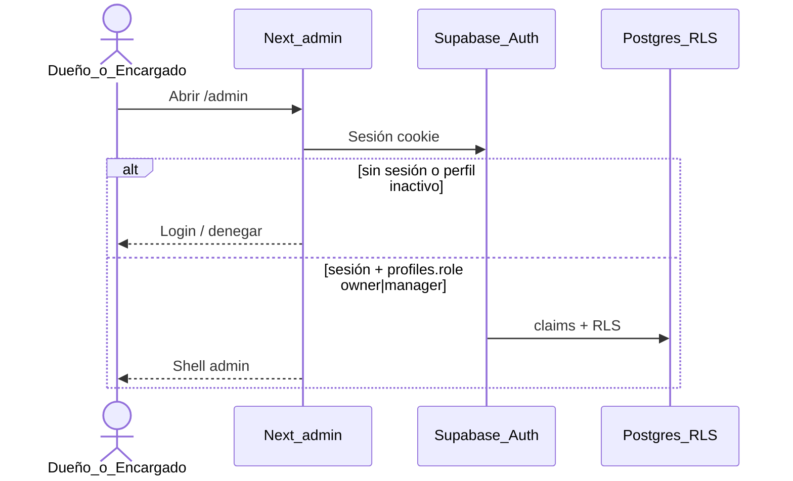
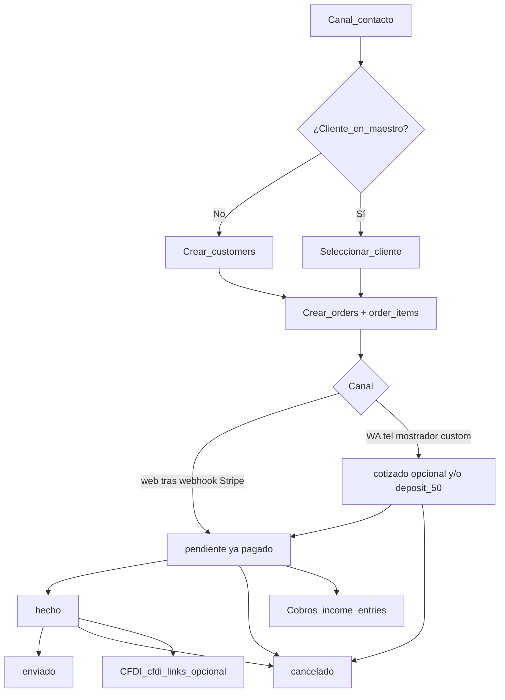
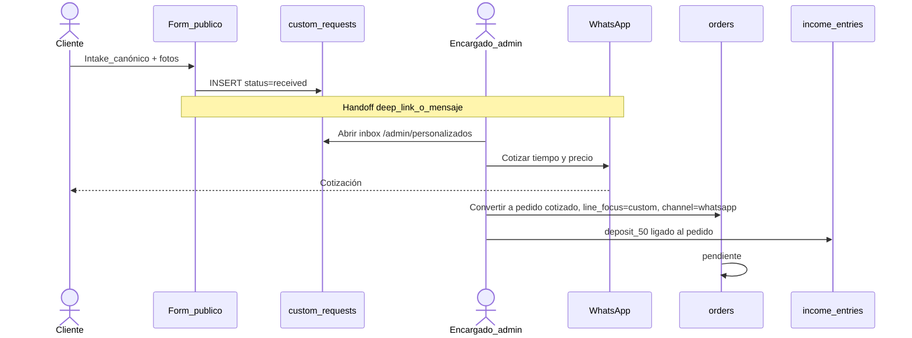
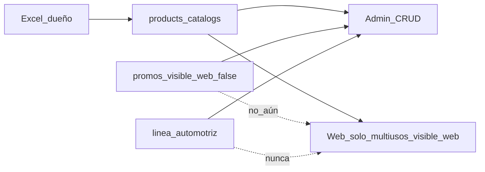

# Flujos — Fase 1

Estado: **Sistema** — admin / pedidos / finanzas operativas, con los cambios de Seguridad ([`SEGURIDAD.md`](SEGURIDAD.md) §13) y las decisiones del dueño 2026-11-11 (envío + estados; **D2 cerrado**; Fabricado express formalizado por el CEO). **Web** — flujos públicos en §3 y §5; IA de pantallas en [`WEB_IA.md`](WEB_IA.md), **alineada** (umbral 2999, estados D2, alta en webhook, sin draft/confirmed).  
**Finanzas:** reglas finas en [`FINANZAS_REGLAS.md`](FINANZAS_REGLAS.md) (propuesta, pendiente OK del dueño).  
Estados de pedido: **cerrados** — `cotizado` (opcional, no web) → `pendiente` → `hecho` → `enviado`, más `cancelado`.

Referencias: [`STACK.md`](STACK.md), [`SCHEMA.md`](SCHEMA.md) (matriz RLS), [`WEB_IA.md`](WEB_IA.md), [`ADMIN_IA.md`](ADMIN_IA.md), [`SEGURIDAD.md`](SEGURIDAD.md), [`CATALOGO.md`](CATALOGO.md), [`FINANZAS_REGLAS.md`](FINANZAS_REGLAS.md), [`KUBOX.md`](../discovery/KUBOX.md).

---

## 1. Auth remoto → admin



- Fail-closed: sin sesión, sin fila en `profiles`, `is_active = false` o rol inválido → denegar (igual que no autenticado). El contrato de quién entra y qué puede mutar está en la matriz RLS de [`SCHEMA.md`](SCHEMA.md), no solo en Seguridad.
- Entrada a `/admin`: sesión válida **y** perfil activo **y** `role ∈ {owner, manager}`.
- **Equipo y fiado en RLS:** cambiar `profiles.role` / `is_active` y `customers.allows_credit` solo `owner`, enforcing en política RLS (no basta ocultarlo en la UI). Manager no se auto-promueve, no desactiva usuarios y no prende ni apaga el fiado. Matriz owner/manager: [`SCHEMA.md`](SCHEMA.md) y [`SEGURIDAD.md`](SEGURIDAD.md) §2.
- **Rate limit de login:** 5–10 fallos / IP / 15 min, clave IP + email; respuesta `429` + Retry-After. Aplicar **antes** de Auth.
- Cookies en producción: HttpOnly + Secure + SameSite=`Lax` (detalle de implementación en [`SEGURIDAD.md`](SEGURIDAD.md) §3).

---

## 2. Pedido multicanal (operación interna)

Canales: `whatsapp` | `phone` | `counter` | `web` (el pedido web entra **ya pagado** en `pendiente`, tras el webhook; ver §5).



### Reglas Sistema

- Un solo modelo `orders` para todos los canales.
- Línea automotriz solo en admin; marcar `order_items.is_automotive` / `line_focus`.
- Sin descuento de stock en ningún paso.
- Authz interna: altas y cambios de estado = sesión staff bajo RLS (`auth_is_staff`). En Fase 1, `owner` y `manager` operan pedidos por igual; la diferencia de rol está en equipo (`profiles.role` / `is_active`) y en `customers.allows_credit`, enforcing en RLS — ver matriz en [`SCHEMA.md`](SCHEMA.md).
- Canal `web`: el anónimo **no** inserta el pedido. El servidor lo crea con service role en el webhook, `status = pendiente`, ya pagado (§5). No hay estado `draft`.
- Cambio de estado: solo staff autenticado, según la máquina de D2 abajo; auditoría vía `updated_at` + `created_by` (ampliar log si Seguridad lo pide).

### Estados (D2 cerrado — decisión del dueño 2026-11-11)

Control interno: `pendiente` → `hecho` → `enviado`, más `cancelado`.

- **`cotizado`:** opcional, **antes** de `pendiente`. Aplica a WhatsApp, teléfono, mostrador y personalizados. El catálogo web no lo usa.
- **Anticipo:** no es estado; es `income_entries.kind = deposit_50`. Esos mismos canales pueden registrar anticipo antes de `pendiente`. En personalizados: no pasar a `pendiente` mientras la suma de ingresos vigentes del pedido sea menor al 50% de `orders.total` (redondeo hacia arriba al centavo).
- **`pendiente`:** cola de cumplimiento. El pedido web **entra aquí ya pagado**, después del webhook de Stripe (pago total del catálogo + flete, si aplica).
- **`hecho`:** fabricado/terminado, aún no enviado.
- **`enviado`:** enviado o entregado. Terminal de éxito. **No hay `closed`:** cobros, saldo y CFDI se siguen en `income_entries` y `cfdi_links`, no en un estado extra. **No pasar a `enviado`** si hay saldo pendiente (`orders.total` − ingresos vigentes), **salvo** que el cliente tenga `allows_credit = true`. Si no hay fiado, hay que cobrar el saldo antes de enviar. Timbrar o vincular CFDI con saldo sigue la misma regla.
- **`cancelado`:** desde `cotizado`, `pendiente` o `hecho`; no desde `enviado`. Si ya hay dinero cobrado (`deposit_50` o Stripe completo), **se retiene**: el `income_entries` original no se borra; no hay devolución automática ni `kind = refund`.
- Fabricado express (**formalizado por el CEO**; no es un estado): si `is_express`, el encargado fija `promised_by` a más tardar al entrar a `pendiente`. `promised_by` = listo en taller (recolección o entrega a paquetería); el tránsito nacional se comunica aparte. Sin SLA numérico; la web no muestra fecha automática; `is_express` no se enciende solo por ser canal web. Detalle en [`D2_ESTADOS.md`](../discovery/D2_ESTADOS.md).

---

## 3. Personalizados → WhatsApp → pedido + anticipo 50%



- Precio **no** fijo en web.
- Al convertir: el pedido nace en `cotizado`, con `line_focus = custom` y `channel = whatsapp` (**nunca** `web`: ese canal está reservado al catálogo Stripe). Anticipo 50% = `income_entries.kind = deposit_50` (efectivo/transferencia/Stripe según caso). **No pasar a `pendiente`** mientras la suma de ingresos vigentes del pedido sea menor al 50% de `orders.total` (redondeo hacia arriba al centavo; [`FINANZAS_REGLAS.md`](FINANZAS_REGLAS.md)). Luego `hecho` → `enviado`, o `cancelado`.
- Campos canónicos: ver NECESIDADES (diámetros, vueltas, calibre, largo, tipo, unidad, espacio, cantidad, fotos).
- **Rate limit del intake:** 5 / IP / 15 min y 3 / teléfono normalizado / hora; respuesta `429`. Aplicar **antes** de escribir en DB o Storage.
- **INSERT anónimo acotado:** allowlist de columnas (intake canónico + contacto + paths de imagen tras upload firmado). WITH CHECK en RLS: `status = 'received'` y `order_id IS NULL`. La API fuerza esos valores y rechaza `status`, `order_id` u otros campos privilegiados del payload.
- **Sin lectura pública del inbox:** el anónimo no hace SELECT, UPDATE ni DELETE de `custom_requests` (tampoco de la fila recién insertada). El inbox vive solo en `/admin/personalizados`, bajo sesión staff.
- **Folio (contrato del alta pública, no código):** un Route Handler inserta en **servidor** y devuelve **solo el folio** a `/personalizados/enviado` (puede ir en la ruta o el query; no es PII). El anónimo **no** hace SELECT ni se confía en `INSERT … RETURNING` bajo RLS sin política de lectura. No se agrega `request_number`; basta el folio actual (prefijo corto del `id`).
- Imágenes: solo vía upload firmado (TTL corto, path opaco, MIME/size allowlist). El anónimo no lee el bucket `custom-samples`.

**UX del form (Web):** ruta `/personalizados`. Campos canónicos de NECESIDADES más nombre y teléfono WhatsApp. Validación de enums/rangos y notas con largo máximo, en servidor. Foto de muestra obligatoria; foto con medidor recomendada (no bloquea el envío). **Sin precio ni lead time** en la página. Copy: cotización por WhatsApp; anticipo 50% al confirmar (el 50% aplica al convertir a pedido, no en este form — [`FINANZAS_REGLAS.md`](FINANZAS_REGLAS.md)).

**Handoff WhatsApp:** tras el INSERT, redirect a `/personalizados/enviado` con folio corto y CTA `https://wa.me/<numero_negocio>?text=...`. Texto propuesto: `Hola, envié una solicitud de resorte personalizado con folio {folio}. Quedo atento a la cotización y el tiempo de entrega.` **Sin PII** (teléfono, email, fotos, domicilio) en la URL (`SEGURIDAD.md` R12). El número de negocio lo entrega el dueño (config, no hardcode de prueba). El anónimo no actualiza `status`; permanece `received` hasta que el staff lo mueva. El clic del cliente a WhatsApp **no** muta el `status`. Conversión a pedido + anticipo = solo admin.

**Estados de `custom_requests`** (sin estados nuevos; ver [`SCHEMA.md`](SCHEMA.md)):

- `received`: alta pública.
- `quoted`: el staff registró la cotización.
- `converted`: nació el pedido.
- `abandoned`: el staff cierra sin convertir.
- `sent_to_whatsapp`: solo si el staff lo marca; el clic del cliente a WhatsApp **no** muta el `status`.

Mapa de pantallas, contratos de API y legales: [`WEB_IA.md`](WEB_IA.md). Personalizados puede afinar el copy del mensaje WA y la validación de fotos.

---

## 4. Finanzas operativas (admin)

### 4.1 Ingresos

```mermaid
flowchart LR
  Pedido[orders] --> Cobro[Registrar_income_entry]
  Cobro --> K{kind}
  K --> P[payment]
  K --> D[deposit_50]
  K --> N[note_cash efectivo local]
  K --> S[stripe]
  K --> F[credit_settlement]
  Cobro --> Metodo[method cash|transfer|stripe|other]
```

| Escenario | kind | Notas |
|-----------|------|-------|
| Anticipo personalizado / trabajo | `deposit_50` | 50% fijado en brief |
| Pago total o saldo | `payment` | |
| Efectivo en mostrador (“nota”) | `note_cash` | Glosario local = efectivo local |
| Checkout web confirmado | `stripe` | Preferible vía webhook (§5) |
| Abono a fiado | `credit_settlement` | Cliente con `allows_credit` |

Registrar **todo** lo que entra. Preferir `order_id` no nulo.

**Fiado (decisión del dueño 2026-11-11):** informal. Sin plazo fijo, sin campo de vencimiento, sin tope en pesos ni en número de pedidos. El saldo se deriva y se muestra en admin. `customers.allows_credit` lo muta **solo el owner**, en RLS (el manager no lo prende ni lo apaga).

**Gate a `enviado` y CFDI:** no pasar a `enviado` si hay saldo pendiente, **salvo** `allows_credit = true`. Timbrar o vincular CFDI con saldo sigue la misma regla. Si no hay fiado, hay que cobrar el saldo antes de enviar.

**Cancelación con dinero ya cobrado:** se retiene. El `income_entries` original no se borra. No hay devolución automática ni `kind = refund`. No se cancela desde `enviado`.


### 4.2 Egresos

```mermaid
flowchart TD
  Gasto[Necesidad_pago] --> Alta[/admin/egresos/nuevo]
  Alta --> Cat[category wire|stones|tools|other]
  Cat --> Save[expense_entries]
```

- Módulo **separado** de ingresos (otra ruta, otra tabla).
- No requiere pedido en MVP.

### 4.3 CFDI (Kubox) — vínculo manual

```mermaid
sequenceDiagram
  actor Op as Usuario_admin
  participant Ped as Pedido_detalle
  participant Kub as Kubox_panel
  participant Link as cfdi_links

  Op->>Ped: Pedido listo para facturar
  Op->>Kub: Timbrar CFDI en Kubox
  Kub-->>Op: UUID / folio / PDF
  Op->>Link: Pegar uuid_cfdi, serie_folio, status=stamped
  Op->>Link: Adjunto PDF/XML opcional
```

- Sistema **no** reemplaza a Kubox.
- Estados: `pending` | `stamped` | `cancelled`.
- Prohibido scraper / API no oficial.

*Fiado y cancelación: decisión del dueño 2026-11-11 (§2, §4 y [`SCHEMA.md`](SCHEMA.md)). Otras reglas finas (reportes, conciliación): [`FINANZAS_REGLAS.md`](FINANZAS_REGLAS.md), que escribe Finanzas.*

---

## 5. Pedido catálogo web + Stripe (Web)

IA, rutas y SEO: [`WEB_IA.md`](WEB_IA.md).  
Checkout web de Fase 1 = **pago total** del catálogo, sin anticipo obligatorio y sin fiado ([`FINANZAS_REGLAS.md`](FINANZAS_REGLAS.md)). Precios de lista solo desde la DB.

```mermaid
sequenceDiagram
  actor C as Cliente_web
  participant Store as Catalogo_publico
  participant API as Next_API
  participant Stripe as Stripe_Checkout
  participant WH as Webhook
  participant DB as orders_income

  C->>Store: Navega catálogo (AND publicación)
  Note over Store: Sin promos UI; sin stock; sin automotriz
  C->>Store: Carrito solo product_id + qty
  C->>API: POST crear Checkout Session
  Note over API: Rate limit; ignora unit_price/total/is_automotive/flete; carga precios y envío de DB
  API->>Stripe: Session con line_items del servidor (subtotal + shipping_fee)
  Note over API,Stripe: No inserta orders todavía
  Stripe-->>C: Pago HTTPS
  C-->>Store: /pedido/exito (no marca pagado)
  Stripe->>WH: checkout.session.completed (firma)
  WH->>DB: service_role: INSERT order pendiente ya pagado + items + income_entries kind=stripe
```

### 5.1 Lectura del catálogo y carrito

- Listados y fichas en servidor (SEO). Solo productos que cumplen el **AND** de [`CATALOGO.md`](CATALOGO.md) §1. Los dos catálogos multiusos se mantienen separados.
- Producto no publicable (automotriz, inactivo, `visible_web = false`, sin precio, etc.) → **404**.
- Carrito en el cliente: únicamente `{ product_id, quantity }` (qty 1–99, máx. 20 líneas). Al pintar `/carrito` y al crear la Session, el servidor **vuelve a leer** `unit_price` de la DB. Si un ítem dejó de ser publicable, se retira y se avisa.
- La API y la UI públicas **no consultan** `promos` (RLS deniega SELECT anónimo en Fase 1).

### 5.2 Crear Session — anti-tampering y actor DB

- **Anti-tampering de precios y flete:** el servidor **ignora** `unit_price`, `total`, `shipping_fee` e `is_automotive` enviados por el cliente. Carga los productos por `id` desde la DB: solo si `visible_web = true` **AND** `is_active = true` **AND** catálogo/línea públicos (`multiusos`) **AND** `unit_price` no nulo. Calcula `line_total` y `subtotal`. Rechaza automotriz o no web en el carrito (400, no se crea Session). Cantidades > 0 con tope; moneda forzada `MXN` (centavos hacia Stripe).
- **Envío (decisión del dueño 2026-11-11):** el flete va **incluido en el total de Stripe**, en el mismo cobro. Umbral **fijo:** si `subtotal >= 2999` MXN, `shipping_fee = 0`. Si `subtotal < 2999`, el cliente paga `shipping_fee_mxn` (setting en `app_settings`; ver [`SCHEMA.md`](SCHEMA.md)). El monto de esa tarifa **aún no está definido: no se inventa**. Si el subtotal es `< 2999` y el setting no tiene valor, **no** se crea la Session. `total = subtotal + shipping_fee`. `shipping_to` se recolecta como texto (p. ej. dirección en Stripe Checkout) y se guarda en el webhook. El umbral 2999 sí puede mostrarse en la UI («envío gratis desde $2,999»).
- **Actor DB — creación de Session (sin alta de pedido):** Route Handler `POST /api/checkout/session`. Calcula precios y flete en servidor; crea la Stripe Session con esos `line_items` (productos + línea de envío si `shipping_fee > 0`). **No inserta** `orders` ni `order_items` (el pedido web entra ya pagado). Puede leer `app_settings` en servidor. El anónimo no tiene INSERT ni SELECT en `orders` / `order_items` (matriz en [`SCHEMA.md`](SCHEMA.md)). `is_express` no se enciende solo por ser web. Metadata de la Session: ids de producto, cantidades y montos calculados (para reconstruir el snapshot en el webhook), no un `order_id` aún inexistente.
- **Rate limit:** 5–10 / IP / 15 min; `429` + Retry-After. Aplicar **antes** de Stripe o de la DB.
- Stripe Checkout Session (no página de pago propia): `locale` es-MX, moneda `MXN`, success/cancel solo `https://`. Métodos: los que el dueño active en el Dashboard de Stripe.
- Service role nunca en el cliente.

### 5.3 Webhook — única fuente que confirma el pago

- **Actor DB — alta del pedido (ya pagado):** webhook `POST /api/webhooks/stripe` con **service role**, solo **después** de verificar la firma (`STRIPE_WEBHOOK_SECRET`) sobre el body crudo. Allowlist: `checkout.session.completed` (y eventos de fallo mínimos si se manejan). Aquí se **inserta** `orders` (`channel = web`, `status = pendiente`, `line_focus = multiusos`, `created_by` nulo, `subtotal` / `shipping_fee` / `total` del cálculo que quedó en la Session, `shipping_to` y contacto desde la Session, `stripe_checkout_session_id` / `stripe_payment_intent_id`) + `order_items` (snapshot; `is_automotive = false`, `is_custom = false`) + `income_entries` (`kind = stripe`, `method = stripe`, monto = `total` cobrado).
- Idempotencia por `event.id` / `checkout_session_id` / payment intent: un solo pedido y un solo `income_entries` por cobro. Si la fila ya existe, no se duplica. Alta manual `kind = stripe` solo por excepción, sin duplicar el mismo intent ([`FINANZAS_REGLAS.md`](FINANZAS_REGLAS.md) §3).
- La URL de success **no** marca el pedido como pagado ni se confía en el querystring.
- Operación admin posterior (`pendiente` → `hecho` → `enviado`, cobros manuales, CFDI): sesión staff + RLS (`auth_is_staff`); nunca service role desde el browser.

### 5.4 Éxito y cancelación

- `/pedido/exito`: agradecimiento y «estamos confirmando el pago». Folio solo si el servidor ya ve el pedido en `pendiente` (resolviendo la Session en servidor, tras el webhook). Sin PII ajena.
- `/pedido/cancelado`: el pago no se completó; el carrito se conserva. **No hay fila de pedido** que limpiar (el alta ocurre solo en el webhook, ya pagado).

---

## 6. Catálogo maestro → superficies (resumen)



---

## Huecos a completar por otros deptos

| Sección | Depto | Qué falta |
|---------|-------|-----------|
| Estados de pedido (D2) + Fabricado express | — | **Cerrado** (dueño 2026-11-11; express formalizado por el CEO): `cotizado` → `pendiente` → `hecho` → `enviado` + `cancelado`. Sin `closed`. Express: ver §2 y [`D2_ESTADOS.md`](../discovery/D2_ESTADOS.md). |
| Monto de tarifa de envío (`shipping_fee_mxn`) | Dueño / CEO | Umbral 2999 y la regla (gratis / mismo cobro) están formalizados. Falta el monto; sin él, el checkout con subtotal `< 2999` no puede crear Session. |
| Form público + SEO + carrito UX | Web | **Hecho** y alineado: [`WEB_IA.md`](WEB_IA.md) incorpora umbral 2999, estados D2 y alta del pedido en el webhook (sin `draft` / `confirmed`). Go-live de dominio (W0) y número WhatsApp (W4) espera al dueño. |
| Fiado y cancelación con cobro | — | **Cerrado** (dueño 2026-11-11): retención si ya hay cobro (sin `kind = refund`); `allows_credit` solo owner en RLS; fiado informal (sin plazo, vencimiento ni tope); gate a `enviado` / CFDI si hay saldo, salvo `allows_credit`. Finanzas lo refleja en [`FINANZAS_REGLAS.md`](FINANZAS_REGLAS.md). |
| Intake WA copy + validación fotos | Personalizados | Afinar §3 |
| Políticas SQL RLS + tests `anon` + firma | Seguridad | Contrato ya en `SCHEMA.md` y este doc; SQL y firma pendientes (`SEGURIDAD.md` §4 / §10) |
| Import Excel columnas exactas | Catálogo | Cuando lleguen archivos |

## Escalación

Cambio de stack, de Stripe, o de “API Kubox / scrapear” → **CEO** (no decidir en Sistema).
