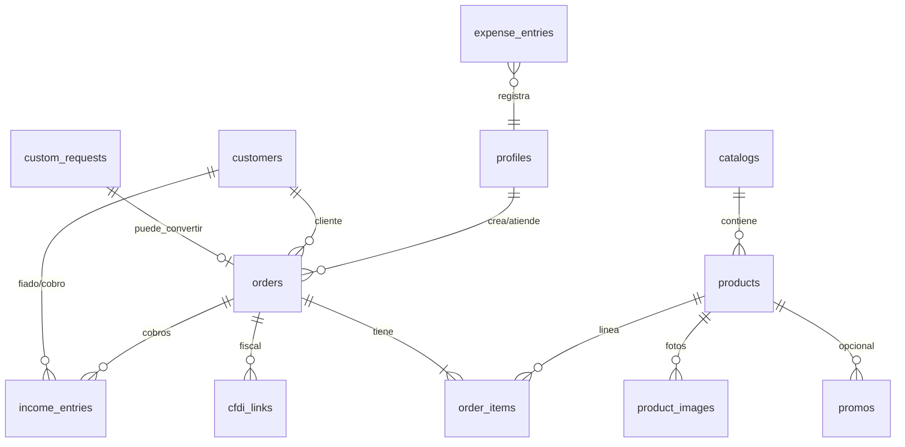

# Schema — Fase 1

App única Next.js + **Supabase Postgres**. Sin tablas ni campos de **stock/inventario**.

Estado: **Gerente Sistema** — cambios de Seguridad ([`SEGURIDAD.md`](SEGURIDAD.md) §13), decisiones del dueño 2026-11-11 (envío + estados; **D2 cerrado**) e integridad de catálogo (veredicto APROBADO CON CAMBIOS). Validación posterior: Catálogo, Pedidos, Personalizados, Finanzas. Políticas SQL + tests con clave `anon` y firma → Seguridad. **Gate:** no cargar datos productivos / PII real hasta ese punto.

Convenciones:

- IDs: `uuid` PK (`gen_random_uuid()`).
- Tiempos: `timestamptz` (`created_at`, `updated_at`).
- Dinero: `numeric(12,2)` MXN.
- Soft delete solo donde se indique; default = hard delete admin controlado o `archived`.
- **Fail-closed:** sin política RLS que permita → denegar.

---

## Diagrama (entidades)

---

## Auth y roles

### `profiles`

Extiende `auth.users` (1:1). Roles operativos Fase 1: **dueño** y **encargado**.

| Columna | Tipo | Notas |
|---------|------|-------|
| `id` | uuid PK | = `auth.users.id` |
| `full_name` | text | |
| `role` | text/enum | `owner` \| `manager` |
| `is_active` | boolean | default true; inactivo → sin acceso admin |
| `created_at` / `updated_at` | timestamptz | |

- Solo perfiles activos con rol válido entran a `/admin`.
- No hay rol “cliente web” en MVP (checkout guest + datos en `orders` / `customers`).

---

## Catálogo maestro

### `catalogs`

Dos listados multiusos (~105 y ~56) + espacio para línea interna.

| Columna | Tipo | Notas |
|---------|------|-------|
| `id` | uuid PK | |
| `code` | text unique | ej. `multiusos_105`, `multiusos_56`, `automotriz` |
| `name` | text | Nombre humano |
| `line` | text/enum | `multiusos` \| `automotriz` |
| `is_public` | boolean | `true` solo multiusos vendibles en web; automotriz = `false` |
| `sort_order` | int | |
| `created_at` / `updated_at` | timestamptz | |

### `products`

Identificación actual: **ID interno / nombre (número)**; SKU formal TBD (columna nullable).

| Columna | Tipo | Notas |
|---------|------|-------|
| `id` | uuid PK | |
| `catalog_id` | uuid FK → catalogs | |
| `external_id` | text | ID/nombre del Excel |
| `name` | text | |
| `sku` | text null | Reservado; no requerido Fase 1 |
| `description` | text null | |
| `tech_sheet` | jsonb/text null | Ficha técnica (C1c) |
| `unit_price` | numeric(12,2) **null** | Precio público de lista. **Nullable:** las filas sin precio se importan al sistema, no a la web. Prohibido inventar un monto para poder importar. |
| `currency` | text | default `MXN` |
| `line` | text/enum | Denormalizado o vía catálogo: `multiusos` \| `automotriz` |
| `is_active` | boolean | |
| `visible_web` | boolean | **default `false`**. Se enciende a mano cuando el ítem está listo para web. |
| `created_at` / `updated_at` | timestamptz | |

**Sin** `stock`, `qty_on_hand`, ni equivalentes.

**Restricciones de integridad (Catálogo, veredicto APROBADO CON CAMBIOS):**

1. **`UNIQUE (catalog_id, external_id)`** — formal, no solo en prosa.
2. **`visible_web` default `false`** (columna, arriba).
3. **`visible_web = true` es imposible** si `line = 'automotriz'` o el catálogo padre no es público (`catalogs.is_public = false`):
   - CHECK en `products`: `(visible_web = false) OR (line = 'multiusos')`.
   - El filtro sobre `catalogs.is_public` no cabe en un CHECK de una sola tabla: trigger o equivalente (BEFORE INSERT/UPDATE de `products`) que rechace `visible_web = true` si el catálogo no es público. Si se cambia `catalogs.is_public` a `false`, no pueden quedar productos con `visible_web = true`.
4. **Publicar exige precio:** `visible_web = true` solo si `unit_price IS NOT NULL` (CHECK: `(visible_web = false) OR (unit_price IS NOT NULL)`). Alineado a [`CATALOGO.md`](CATALOGO.md) §1. Las filas con `unit_price` nulo viven en el maestro/admin; no salen a la web (el AND de publicación y el checkout ya exigen precio no nulo).

### `product_images`

| Columna | Tipo | Notas |
|---------|------|-------|
| `id` | uuid PK | |
| `product_id` | uuid FK → products | |
| `storage_path` | text | Bucket Supabase Storage |
| `alt_text` | text null | |
| `sort_order` | int | |
| `is_primary` | boolean | |
| `created_at` | timestamptz | |

### `promos`

Existen en datos; **ocultas al público** por defecto ([BRIEF](../negocio/BRIEF.md), C1a).

| Columna | Tipo | Notas |
|---------|------|-------|
| `id` | uuid PK | |
| `product_id` | uuid FK null → products | Padre producto; exactamente uno de los dos (ver CHECK) |
| `catalog_id` | uuid FK null → catalogs | Padre catálogo; exactamente uno de los dos (ver CHECK) |
| `name` | text | |
| `promo_price` | numeric(12,2) null | |
| `percent_off` | numeric(5,2) null | Alternativa a precio fijo |
| `starts_at` / `ends_at` | timestamptz null | |
| `visible_web` | boolean | **default `false`** Fase 1 |
| `is_active` | boolean | |
| `created_at` / `updated_at` | timestamptz | |

**CHECK de padre único:** exactamente un padre — `(product_id IS NOT NULL AND catalog_id IS NULL) OR (product_id IS NULL AND catalog_id IS NOT NULL)`. Ni ambos ni ninguno.

Regla Fase 1: RLS **deniega todo SELECT** anónimo sobre `promos` (no basta filtrar `visible_web = false`). La app pública **no consulta** esta tabla. `visible_web` permanece en default `false` para un eventual uso futuro; activarlo no implica exposición pública hasta que Seguridad reabra la política.

---

## Clientes

### `customers`

| Columna | Tipo | Notas |
|---------|------|-------|
| `id` | uuid PK | |
| `name` | text | |
| `phone` | text null | |
| `email` | text null | |
| `notes` | text null | |
| `allows_credit` | boolean | Fiado informal. Mutable **solo** por `auth_is_owner()` en RLS (mismo criterio que `profiles.role` / `is_active`). El manager no lo prende ni lo apaga. |
| `is_automotive_existing` | boolean | Cliente existente automotriz |
| `created_at` / `updated_at` | timestamptz | |

Saldo de crédito: **derivado** de pedidos + `income_entries` (no campo stock-like suelto en MVP); vista o query en admin.

**Fiado (decisión del dueño 2026-11-11):** informal. Sin plazo fijo, sin campo de vencimiento, sin tope en pesos ni en número de pedidos. El saldo se deriva (ya está) y se muestra en admin. No se agregan columnas de vencimiento ni de límite.

---

## Pedidos

### `orders`

Pedido **unificado** multicanal (web, WhatsApp, teléfono, mostrador).

| Columna | Tipo | Notas |
|---------|------|-------|
| `id` | uuid PK | |
| `order_number` | text unique | Legible humano |
| `channel` | text/enum | `web` \| `whatsapp` \| `phone` \| `counter` |
| `status` | text/enum | Ver estados cerrados (D2) abajo |
| `customer_id` | uuid FK null → customers | |
| `customer_name_snapshot` | text | Guest / mostrador |
| `customer_phone_snapshot` | text null | |
| `customer_email_snapshot` | text null | |
| `line_focus` | text/enum | `multiusos` \| `custom` \| `automotive` \| `mixed` |
| `is_express` | boolean | Fabricado express |
| `promised_by` | timestamptz null | Compromiso entrega |
| `shipping_to` | text null | Destino de envío (nacional / local); texto libre |
| `shipping_fee` | numeric(12,2) | Snapshot del flete cobrado: `0` si `subtotal >= 2999`; si no, el valor vigente de `shipping_fee_mxn`. Lo calcula el servidor; no hay monto por defecto inventado. |
| `subtotal` | numeric(12,2) | Suma de líneas (productos) |
| `total` | numeric(12,2) | `subtotal + shipping_fee` — este es el monto del cobro Stripe en canal web |
| `currency` | text | `MXN` |
| `stripe_checkout_session_id` | text null | Solo canal web |
| `stripe_payment_intent_id` | text null | |
| `notes_internal` | text null | |
| `created_by` | uuid FK null → profiles | Null si web guest |
| `created_at` / `updated_at` | timestamptz | |

**Estados (D2 cerrado — decisión del dueño 2026-11-11):**  
`cotizado` → `pendiente` → `hecho` → `enviado`, más `cancelado`.

| Estado | Uso |
|--------|-----|
| `cotizado` | Opcional, **antes** de `pendiente`. Canales WhatsApp, teléfono, mostrador y personalizados. El canal `web` (catálogo + Stripe) **no** pasa por aquí. |
| `pendiente` | Cola de cumplimiento. Un pedido **web entra aquí ya pagado**, tras el webhook de Stripe. |
| `hecho` | Trabajo/fabricación terminada, aún no enviado. |
| `enviado` | Enviado o entregado. Estado terminal de éxito. **No pasar aquí** si hay saldo pendiente (`orders.total` − ingresos vigentes), **salvo** que el cliente tenga `allows_credit = true`. Si no hay fiado, hay que cobrar el saldo antes de enviar. Timbrar o vincular CFDI con saldo sigue la misma regla. |
| `cancelado` | Alternativa desde `cotizado`, `pendiente` o `hecho`. No desde `enviado`. Si ya hay dinero cobrado (`deposit_50` o Stripe completo), **se retiene**: el `income_entries` original no se borra; no hay devolución automática ni `kind = refund`. |

**Anticipo** no es un estado: es `income_entries.kind = deposit_50`. WhatsApp, teléfono, mostrador y personalizados pueden registrar cotización y/o anticipo **antes** de pasar a `pendiente`. En personalizados no se pasa a `pendiente` mientras la suma de ingresos vigentes del pedido sea menor al 50% de `orders.total`, redondeado hacia arriba al centavo.

**Cancelación con dinero ya cobrado** (decisión del dueño 2026-11-11): desde `cotizado`, `pendiente` o `hecho` (**no** desde `enviado`). Si ya hay cobro (`deposit_50` o Stripe completo), **se retiene**. El `income_entries` original **no se borra**. No hay devolución automática ni `kind = refund`.

**Gate a `enviado`:** no pasar a `enviado` si hay saldo pendiente (`orders.total` − suma de ingresos vigentes), **salvo** que el cliente tenga `allows_credit = true`. Timbrar o vincular CFDI con saldo sigue la misma regla. Si no hay fiado, hay que cobrar el saldo antes de enviar.

**No se agrega `closed`** después de `enviado`. El control operativo termina en `enviado`. Cobros, saldo y CFDI viven en `income_entries` y `cfdi_links` (derivados), no en un estado extra de pedido. No hay regla de negocio que exija un cierre formal posterior.

**Envío (decisión del dueño 2026-11-11), canal web / Stripe:** el flete va **incluido en el total** del mismo cobro Stripe. Si `subtotal >= 2999` MXN (umbral **fijo**), `shipping_fee = 0`. Si `subtotal < 2999`, el cliente paga la tarifa configurable `shipping_fee_mxn` en ese mismo cobro. El monto de la tarifa **aún no está definido**: no se inventa; ver `app_settings` abajo. `shipping_to` sigue siendo texto. El servidor calcula `shipping_fee` y `total`; se ignora cualquier flete enviado por el cliente.

### `order_items`

| Columna | Tipo | Notas |
|---------|------|-------|
| `id` | uuid PK | |
| `order_id` | uuid FK → orders | |
| `product_id` | uuid FK null → products | Null si línea libre / personalizado |
| `description` | text | Snapshot nombre |
| `quantity` | numeric(12,2) | |
| `unit_price` | numeric(12,2) | Snapshot |
| `line_total` | numeric(12,2) | |
| `is_custom` | boolean | |
| `is_automotive` | boolean | Solo interno; nunca origen web |

Sin reserva de inventario.

---

## Personalizados

### `custom_requests`

Intake canónico ([NECESIDADES](../discovery/NECESIDADES.md)); salida → WhatsApp; anticipo 50% al convertir a pedido.

| Columna | Tipo | Notas |
|---------|------|-------|
| `id` | uuid PK | |
| `status` | text/enum | `received` \| `sent_to_whatsapp` \| `quoted` \| `converted` \| `abandoned` |
| `inner_diameter` | numeric | |
| `outer_diameter` | numeric | |
| `turns` | numeric | Nº de vueltas |
| `wire_gauge` | text | Calibre |
| `length_desired` | numeric | |
| `spring_type` | text/enum | `tension` \| `compression` \| `torsion` |
| `unit` | text/enum | `in` \| `mm` |
| `coil_spacing` | numeric null | Espacio entre vueltas |
| `quantity` | numeric | |
| `sample_image_path` | text null | Storage |
| `measurement_image_path` | text null | Ideal: foto con medidor |
| `contact_name` | text | |
| `contact_phone` | text | WhatsApp |
| `contact_notes` | text null | |
| `order_id` | uuid FK null → orders | Tras conversión |
| `created_at` / `updated_at` | timestamptz | |

**Máquina de `status`** (sin estados nuevos):

- `received`: alta pública (único valor que escribe el alta anónima; la API lo fuerza, junto con `order_id IS NULL`).
- `quoted`: el staff registró la cotización.
- `converted`: nació el pedido (`order_id` asignado).
- `abandoned`: el staff cierra sin convertir.
- `sent_to_whatsapp`: solo si el staff lo marca. El clic del cliente al CTA de WhatsApp **no** muta el `status` (el anónimo no tiene UPDATE).

**Folio:** no se agrega `request_number`. El folio actual (prefijo corto del `id`) basta; es el mismo en el handoff, el inbox y el detalle admin. El contrato del alta pública (Route Handler, sin SELECT anónimo) está en [`FLUJOS.md`](FLUJOS.md) §3.

---

## Finanzas

Ingresos ≠ egresos (módulos y tablas separados). Registrar **todo**.

### `income_entries`

Cobros, anticipos 50%, notas (efectivo local), Stripe, abonos a fiado.

| Columna | Tipo | Notas |
|---------|------|-------|
| `id` | uuid PK | |
| `order_id` | uuid FK null → orders | Preferible ligado |
| `customer_id` | uuid FK null → customers | |
| `kind` | text/enum | `payment` \| `deposit_50` \| `note_cash` \| `stripe` \| `credit_settlement` \| `other` |
| `amount` | numeric(12,2) | > 0 |
| `currency` | text | `MXN` |
| `method` | text/enum | `cash` \| `transfer` \| `stripe` \| `other` |
| `stripe_payment_intent_id` | text null | UNIQUE parcial: único donde no sea nulo (varios nulos permitidos) |
| `occurred_at` | timestamptz | Cuándo entró el dinero |
| `notes` | text null | |
| `recorded_by` | uuid FK null → profiles | Nulo en altas del webhook de Stripe (igual que `orders.created_by` en canal web). Obligatorio en altas de admin. |
| `created_at` / `updated_at` | timestamptz | |

**Único parcial:** `UNIQUE (stripe_payment_intent_id) WHERE stripe_payment_intent_id IS NOT NULL`. Formaliza la idempotencia que ya exigen [`SEGURIDAD.md`](SEGURIDAD.md) §8 y [`FLUJOS.md`](FLUJOS.md) §5.3.

**Nota** = pago físico en efectivo en el local (`kind = note_cash`, `method = cash`).

### `expense_entries`

Salidas: alambre, piedras, proveedores, otros. Separado de ingresos.

| Columna | Tipo | Notas |
|---------|------|-------|
| `id` | uuid PK | |
| `category` | text | ej. `wire`, `stones`, `tools`, `other` |
| `vendor_name` | text null | |
| `amount` | numeric(12,2) | > 0 |
| `currency` | text | `MXN` |
| `method` | text/enum | `cash` \| `transfer` \| `other` |
| `occurred_at` | timestamptz | |
| `notes` | text null | |
| `recorded_by` | uuid FK → profiles | |
| `created_at` / `updated_at` | timestamptz | |

Sin `order_id` obligatorio en MVP (gastos operativos generales).

### `cfdi_links`

Vínculo manual Kubox ([KUBOX.md](../discovery/KUBOX.md)). No emite CFDI el sistema.

| Columna | Tipo | Notas |
|---------|------|-------|
| `id` | uuid PK | |
| `order_id` | uuid FK → orders | |
| `status` | text/enum | `pending` \| `stamped` \| `cancelled` |
| `uuid_cfdi` | text null | UUID del XML |
| `serie_folio` | text null | Folio/serie Kubox |
| `kubox_note` | text null | “Timbrado en Kubox” / URL nota |
| `pdf_storage_path` | text null | Adjunto opcional |
| `xml_storage_path` | text null | Adjunto opcional |
| `recorded_by` | uuid FK → profiles | |
| `stamped_at` | timestamptz null | |
| `created_at` / `updated_at` | timestamptz | |

---

## Parámetros de operación (`app_settings`)

Tabla clave/valor para parámetros de negocio configurables. Fase 1 formaliza el envío web:

| `key` | Tipo del valor | Valor | Quién lo cambia |
|-------|----------------|-------|-----------------|
| `shipping_free_threshold_mxn` | numeric | **2999** (fijo, decisión del dueño 2026-11-11) | No mutable en operación; un cambio exigiría nueva decisión del dueño |
| `shipping_fee_mxn` | numeric(12,2) | **Sin valor inicial.** No se inventa un monto. | Solo `owner` |

Hasta que `shipping_fee_mxn` tenga valor: si el `subtotal` es `>= 2999`, el checkout puede proceder (flete = 0); si es `< 2999`, **no** se crea la Checkout Session (no hay flete que cobrar sin inventar precio). Hueco operativo: falta el monto que defina el dueño.

---

## Storage (buckets lógicos)

Políticas alineadas a [`SEGURIDAD.md`](SEGURIDAD.md) §9. Prohibido el listing público de buckets sensibles. Público **solo** fotos de catálogo web; samples y CFDI nunca públicos.

| Bucket | Contenido | Lectura | Escritura |
|--------|-----------|---------|-----------|
| `product-images` | Fotos de catálogo | **Pública** solo objetos cuyo producto padre pasa el filtro web: `visible_web = true`, `is_active = true`, catálogo/línea públicos (`multiusos`). Sin automotriz. | Solo staff |
| `custom-samples` | Fotos de intake | Solo staff (descarga firmada o proxy admin). Anónimo: denegar lectura directa. | Staff + **upload firmado acotado** desde el form público (TTL corto, path opaco, MIME/size allowlist) |
| `cfdi-attachments` | PDF/XML | Solo staff | Solo staff |

---

## RLS (contrato mínimo — alineado a [`SEGURIDAD.md`](SEGURIDAD.md) §4)

`ENABLE ROW LEVEL SECURITY` en **todas** las tablas de negocio. Sin política explícita que permita → denegar (fail-closed).

Helpers de intent: `auth_is_staff()`, `auth_is_owner()` — se evalúan contra `profiles` (sesión válida + `is_active = true` + rol válido), no contra claims JWT sueltos.

Staff = sesión válida **y** fila en `profiles` con `is_active = true` **y** `role ∈ {owner, manager}`. Sin fila, rol desconocido o inactivo → igual que anónimo (denegar).

Service role **bypasea RLS**: solo en servidor (Route Handlers, webhook Stripe, altas web de pedidos). Nunca en el cliente ni en el repo.

### Matriz tabla × anon × staff

| Tabla | Anon / no staff | Staff (`auth_is_staff`) | Notas |
|-------|-----------------|-------------------------|-------|
| `catalogs` | SELECT si `is_public = true` | CRUD | Automotriz y no públicos invisibles al anónimo |
| `products` | SELECT si `visible_web = true` **AND** `is_active = true` **AND** línea/catálogo público (`line = 'multiusos'` / catálogo `is_public`) | CRUD | Defensa en profundidad: no confiar solo en un flag |
| `product_images` | SELECT si el producto padre pasa el filtro público (EXISTS al producto) | CRUD | Atado al producto; no solo por path |
| `promos` | **Denegar SELECT** (y el resto de verbos) en Fase 1 | CRUD | Obligatorio en RLS; la app pública no consulta esta tabla |
| `customers` | Denegar | CRUD; UPDATE de `allows_credit` **solo `auth_is_owner()`** | PII. El manager no prende ni apaga el fiado. Enforcing en RLS, no solo en la UI. |
| `orders` | Denegar SELECT/INSERT/UPDATE/DELETE | CRUD | Altas del canal web **solo service role** en API de servidor |
| `order_items` | Denegar SELECT/INSERT/UPDATE/DELETE | CRUD | Igual: escrituras públicas solo vía service role |
| `custom_requests` | **INSERT acotado** (abajo); SELECT/UPDATE/DELETE denegar | SELECT + UPDATE; DELETE según política | El anónimo no elige `status` ni `order_id` |
| `income_entries` | Denegar | CRUD | Stripe escribe con service role |
| `expense_entries` | Denegar | CRUD | |
| `cfdi_links` | Denegar | CRUD | |
| `profiles` | Denegar | SELECT equipo; UPDATE de `role` / `is_active` **solo `auth_is_owner()`** | Manager no escala rol ni desactiva usuarios. Enforcing en RLS, no solo en la UI `/admin/equipo`. |
| `app_settings` | Denegar SELECT/escrituras directas | SELECT staff; UPDATE de `shipping_fee_mxn` **solo owner**; el umbral 2999 no se actualiza por API | El umbral y la tarifa (cuando exista) se exponen al público solo vía Route Handler de servidor, no con SELECT anónimo a la tabla (puede crecer con claves no públicas). |

### `custom_requests`: INSERT anónimo (allowlist + WITH CHECK)

- **WITH CHECK:** `status = 'received'` **y** `order_id IS NULL`.
- **Columnas permitidas (allowlist):** intake canónico + contacto + paths de imagen **después** del upload firmado: `inner_diameter`, `outer_diameter`, `turns`, `wire_gauge`, `length_desired`, `spring_type`, `unit`, `coil_spacing`, `quantity`, `sample_image_path`, `measurement_image_path`, `contact_name`, `contact_phone`, `contact_notes`.
- **Rechazar o descartar** en la API y en RLS: `status`, `order_id` u otros campos privilegiados enviados en el payload. La API fuerza `status = 'received'` y `order_id = null` en el alta pública.
- Anónimo: **sin SELECT** (no lee el inbox, ni filas ajenas, ni la propia tras insertar), sin UPDATE, sin DELETE.

### Pedidos web: solo service role

El anónimo **no** tiene políticas de lectura ni de escritura sobre `orders` ni `order_items`. El pedido web **se inserta ya pagado** (`status = pendiente`) en el webhook de Stripe, con **service role**, solo tras verificar la firma: cabecera, ítems (snapshot de precios) y `income_entries`. La creación de la Checkout Session calcula precios y flete en el servidor (anti-tampering, [`FLUJOS.md`](FLUJOS.md) §5) y **no** deja una fila de pedido impaga. No hay estado `draft`.

### `profiles`: mutaciones sensibles solo owner

- `role` e `is_active` son mutables **solo** por `auth_is_owner()` en políticas RLS (UPDATE restringido a esas columnas, o política equivalente).
- Manager: puede hacer SELECT del equipo; **no** UPDATE de `role` ni `is_active`; **no** auto-promoción a owner.
- Anónimo: denegar todo.

### `customers.allows_credit`: mutable solo owner

- `allows_credit` es mutable **solo** por `auth_is_owner()` en políticas RLS (mismo criterio que `profiles.role` / `is_active`: UPDATE restringido a esa columna, o política equivalente).
- Manager: puede SELECT y el resto del CRUD de clientes; **no** UPDATE de `allows_credit` (ni prenderlo ni apagarlo).
- Anónimo: denegar todo.

### Anónimo no ve (API, RLS ni Storage)

- Línea **automotriz** (catálogos, productos e imágenes).
- **Promos** (ningún SELECT en Fase 1).
- `customers` (PII).
- `orders` y `order_items`.
- `income_entries` y `expense_entries`.
- `cfdi_links` y el bucket `cfdi-attachments`.
- `profiles`.
- Inbox de `custom_requests` y lectura directa del bucket `custom-samples`.

### Pruebas de aceptación (clave `anon`) — gate antes de datos reales

Alineadas a [`SEGURIDAD.md`](SEGURIDAD.md) §4. No cargar PII ni datos productivos hasta tener políticas SQL, estos tests y la firma de Seguridad.

1. `products` → cero filas automotriz o con `visible_web = false`.
2. `promos`, `customers`, `orders`, `profiles`, finanzas, `cfdi_links` → vacío o denegado.
3. INSERT en `custom_requests` con `status = 'converted'` o con `order_id` asignado → rechazado.
4. Lectura directa de Storage en `custom-samples` / `cfdi-attachments` → denegada.

---

## Fuera de schema Fase 1

- Inventario / movimientos de stock.
- Tablas de marketing automotriz público.
- API Kubox / PAC alterno.
- Portal de cliente con login.
- Conciliación bancaria multi-cuenta.

## Aceptación (PM Sistema)

1. Cubiertas épicas C1–C5 y S1–S5 a nivel tablas (sin stock).
2. Promos con `visible_web` default false, y exactamente un padre (`product_id` XOR `catalog_id`).
3. Ingresos y egresos en tablas distintas.
4. CFDI = vínculo, no emisión.
5. Automotriz modelable (`catalogs.line`, `products`, `order_items.is_automotive`) sin exponerse en lecturas públicas.
6. Seguridad firma políticas RLS (SQL + tests con clave `anon`) antes de cargar datos reales / PII.
7. Esta matriz RLS queda alineada a [`SEGURIDAD.md`](SEGURIDAD.md) §4: incluye `product_images`, deny SELECT de `promos` al anónimo, allowlist + WITH CHECK en `custom_requests`, altas web de `orders` solo vía service role, y `profiles.role` / `is_active` y `customers.allows_credit` mutables solo por owner en RLS.
8. Estados de pedido = D2 cerrado: `cotizado` (opcional, no web), `pendiente` → `hecho` → `enviado`, más `cancelado`. Sin `closed`. Pedido web entra en `pendiente` ya pagado tras el webhook.
9. Envío web: umbral fijo 2999 MXN (gratis a partir de ahí); tarifa `shipping_fee_mxn` configurable, sin monto inventado; flete incluido en el total de Stripe; snapshot en `orders.shipping_fee`.
10. Integridad de catálogo (veredicto Catálogo): `products.visible_web` default false; CHECK/trigger impide `visible_web = true` si automotriz o catálogo no público; `UNIQUE (catalog_id, external_id)`; `unit_price` nullable (publicar exige no nulo, sin inventar precios al importar).
