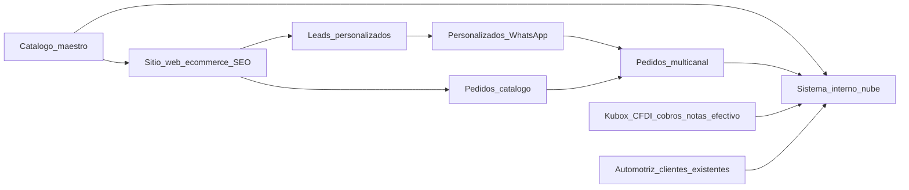

# Mapa de necesidades — Fase 0 (hechos del dueño)

Estado: **discovery cerrado en lo esencial** (2026-11-11). Ver [`PREGUNTAS_ABIERTAS.md`](PREGUNTAS_ABIERTAS.md) para gaps menores.

## Productos futuros

### A. Sitio web (público)

| Necesidad | Depto | Notas |
|-----------|-------|-------|
| SEO nacional (resortes y similares) | Web | Dominio/redes por crear; objetivo ranking alto |
| Landing Fabricado express + envíos México | Web | Horas/días vs semanas competencia |
| Catálogo multiusos vendible online | Catálogo + Web | Precios públicos + promos; sin stock |
| Checkout / pedido de catálogo | Web + Pedidos + Finanzas | **Stripe**; canal nuevo además de WA/tel/mostrador |
| Promos en datos (ocultas al público) | Catálogo + Web | Presentes en maestro; no UI pública por ahora |
| Intake personalizados → WhatsApp | Personalizados + Web | Cotización dinámica; no precio fijo en web |
| Fotos editadas (fondo/colores) | Catálogo + Web | Pipeline de assets |
| HTTPS, rate limit, formularios seguros | Seguridad + Web | |
| Sin automotriz | Web + Catálogo | |

### B. Sistema interno (nube / remoto)

| Necesidad | Depto | Notas |
|-----------|-------|-------|
| Auth + roles (dueños, encargado) | Seguridad + Sistema | Fail-closed; acceso remoto |
| Catálogo maestro (ID/nombre; SKU formal TBD) | Catálogo | Import desde Excel; fichas técnicas en progreso |
| Línea automotriz | Sistema | Visible; no principal; solo clientes existentes |
| Clientes + crédito / fiados | Sistema + Finanzas | |
| Pedidos multicanal | Pedidos + Sistema | Web, WhatsApp, teléfono, mostrador |
| Personalizados + anticipo 50% | Personalizados + Finanzas | Campos de intake definidos |
| Módulo **ingresos** (cobros, anticipos, efectivo/notas, Stripe) | Finanzas | Registrar todo lo que entra |
| Módulo **egresos** (alambre, piedras, otros) | Finanzas | Separado de ingresos; registrar todo lo que sale |
| Facturación CFDI (Kubox) | Finanzas | Timbrar en Kubox; vínculo manual al pedido ([`KUBOX.md`](KUBOX.md)) |
| Sin inventario/stock en MVP | Catálogo + Sistema | Decisión explícita |

## Procesos actuales → requisito futuro

| Proceso | Cómo se hace hoy | Dolor / riesgo | Requisito futuro |
|---------|------------------|----------------|------------------|
| Consulta catálogo | Excel | Difícil de compartir / SEO nulo | Catálogo web + maestro |
| Venta catálogo | WA / tel / mostrador | No escala nacional | E-commerce + mismos pedidos en sistema |
| Pedido express | Personas (dueños/encargado) | Todo en papel/chat | Estados digitales + promesa express |
| Personalizado | Medidas/foto → WA → cotiza | Intake incompleto | Form web con campos fijos → WA |
| Anticipo | 50% trabajos | Seguimiento manual | Cobro/anticipo ligado a pedido |
| Facturación | Kubox CFDI | Desligado de pedido digital | Pedido ↔ CFDI (link o API) |
| Fiados | Crédito a conocidos | Memoria / papel | Cliente + saldo en sistema |
| Efectivo local | “Notas” en papel | Pérdida de rastro | Registro de nota/efectivo |
| Proveedores | Pagar alambre/piedras cuando se pueda | Informal | Egresos simples (no bloqueante MVP) |
| Automotriz | Clientes viejos | Mezcla con marketing | Solo interno; no web |

## Intake personalizados (canónico)

Obligatorios / fuertes:

1. Diámetro interior y exterior  
2. Número de vueltas  
3. Calibre del alambre  
4. Largo / longitud deseada  
5. Tipo: tensión | compresión | torsión  
6. Unidad: pulgadas | milímetros  
7. Espacio entre vueltas  
8. Cantidad  
9. Foto de muestra  
10. Ideal: foto con aparato de medición en la pieza  

Salida del proceso web: paquete de datos → **WhatsApp** para cotización y tiempo (no precio fijo online). Anticipo **50%**.

## Dependencias

1. **Catálogo maestro + fotos** desbloquean e-commerce y SEO de producto.
2. **Pedido unificado** desbloquea cobros, anticipos, notas efectivo y vínculo a Kubox.
3. **Nube + auth** desbloquean operación remota de dueños/encargado.
4. **Stripe** desbloquea cierre online de catálogo.
5. **Stock** fuera de alcance actual; **promos** en datos, no en UI pública.

## Fuera de alcance ahora

- Elegir stack concreto (solo constraint: nube, HTTPS, remoto)
- Implementar código de producto
- Mostrar/usar inventario
- Promoción o captación nueva automotriz
